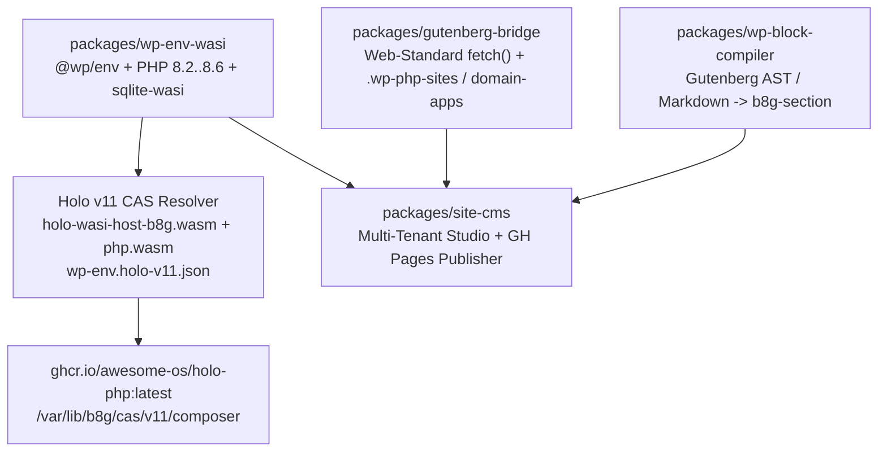

# Awesome-OS WordPress Ecosystem (`@awesome-os/wordpress-ecosystem`)

Sovereign WordPress, WordPress-JS, `@wp/env` PHP-WASI, Gutenberg Block Compiler, and Multi-Tenant Sovereign CMS monorepo built with zero runtime dependencies (`erasableSyntaxOnly: true` `.mts`) over **Holo v11 CAS** (`B8G_ABI_MAGIC_V3 = 0x33564742`) and [`ghcr.io/awesome-os/holo-php:latest`](https://github.com/awesome-os/dockerimages/blob/main/holo-php/Dockerfile).

---

## Architecture



---

## Packages

| Package | Path | Purpose | Tests |
| :--- | :--- | :--- | :--- |
| **`wp-env-wasi`** | [`packages/wp-env-wasi/`](packages/wp-env-wasi/wp-env-wasi.mts) | `.wp-env.json` + `.wp-env.override.json` schema (`PHP 8.2..8.6`), `sqlite-wasi` `wp-config.php` generator, `WpEnvWasiManager`, Holo `v11` CAS resolver &amp; `wp-env.holo-v11.json` emitter | [`wp-env-wasi.test.mts`](packages/wp-env-wasi/wp-env-wasi.test.mts) |
| **`wp-block-compiler`** | [`packages/wp-block-compiler/`](packages/wp-block-compiler/wp-block-compiler.mts) | Gutenberg comment-block &amp; JSON `WpBlock[]` parser + Markdown compiler emitting dark-glass HTML5 `<b8g-section data-kind="cms-page">` | [`wp-block-compiler.test.mts`](packages/wp-block-compiler/wp-block-compiler.test.mts) |
| **`gutenberg-bridge`** | [`packages/gutenberg-bridge/`](packages/gutenberg-bridge/gutenberg-app.mts) | Zero-dependency `createGutenbergApp`, `discoverGutenbergRoutes`, `DEFAULT_EXPERIMENTS_SCHEMA`, and multi-tenant `.wp-php-sites` / `domain-apps` route projection | [`gutenberg-app.test.mts`](packages/gutenberg-bridge/gutenberg-app.test.mts) |
| **`site-cms`** | [`packages/site-cms/`](packages/site-cms/server.mts) | Atomic multi-tenant `CmsStore`, dark-glass CMS Studio (`:7499`), PHP-WASI sandbox panel, and GitHub Pages staging/publisher | [`cms-core.test.mts`](packages/site-cms/cms-core.test.mts), [`server.test.mts`](packages/site-cms/server.test.mts) |

---

## Usage

### 1. `@wp/env` PHP-WASI &amp; Holo `v11` CAS Lock

```ts
import {
  parseWpEnvJson,
  resolvePhpWasmCas,
  WpEnvWasiManager,
} from './packages/wp-env-wasi/wp-env-wasi.mts';

const config = parseWpEnvJson(
  JSON.stringify({ phpVersion: '8.5', multisite: true }),
  JSON.stringify({ port: 8890 }),
);

const cas = resolvePhpWasmCas(config.phpVersion);
console.log(cas.abiMagic, cas.wasiHost, cas.phpWasmCasUri);

const manager = new WpEnvWasiManager('./.b8g-cas/site-cms');
const env = manager.createEnv({
  tenantId: 'awesome-os',
  siteId: 'awesome-os-com',
  name: 'wp-wasi-prod',
  envConfig: config,
});
manager.startEnv(env.id); // writes wp-config.php, .wp-env.json, and wp-env.holo-v11.json
```

### 2. Gutenberg Bridge &amp; Multi-Tenant Domain Apps

```ts
import {
  createGutenbergApp,
  discoverGutenbergRoutes,
  DEFAULT_EXPERIMENTS_SCHEMA,
} from './packages/gutenberg-bridge/gutenberg-app.mts';

const app = createGutenbergApp({
  wpPhpSitesDir: './.wp-php-sites',
  domainAppsDir: './src/wp-content/domain-apps',
  basePath: '/gutenberg',
});

const response = await app.fetch(new Request('https://example.invalid/gutenberg/routes'));
console.log(await response.json());
```

### 3. Containerized PHP + Composer over Shared Holo `v11` CAS

```sh
docker run --rm \
  -v ~/.b8g/cas:/var/lib/b8g/cas \
  ghcr.io/awesome-os/holo-php:latest \
  sh -c 'php -v && composer --version && holo-pm --version'
```

---

## Documentation &amp; Consolidation Audit

- **[`docs/WORDPRESS-JS-CONSOLIDATION-AUDIT.md`](docs/WORDPRESS-JS-CONSOLIDATION-AUDIT.md)** — Complete consolidation mapping from `Apps/wordpress-js/`, `intersections/b8g-site-cms/`, `dockerimages/docker-wordpress`, and `frank-dspeed/*` onto `awesome-os/wordpress-ecosystem`.

---

## Verification

```powershell
# Run all unit & integration suites natively on Node 22/24/26
node --test `
  packages/wp-env-wasi/wp-env-wasi.test.mts `
  packages/wp-block-compiler/wp-block-compiler.test.mts `
  packages/gutenberg-bridge/gutenberg-app.test.mts `
  packages/site-cms/cms-core.test.mts `
  packages/site-cms/server.test.mts

# Or via npm script
npm test

# Awesome-OS root workspace verification gates (from E:\awesome-os)
.\bin\b8g-web-doc.ps1 github-mirror\awesome-os\wordpress-ecosystem\README.md github-mirror\awesome-os\wordpress-ecosystem\docs\WORDPRESS-JS-CONSOLIDATION-AUDIT.md
.\bin\holo-ci.ps1 verify --cwd github-mirror\awesome-os\wordpress-ecosystem
```

---

## CI (`holo-ci@v1`)

This repository is verified on every push to `main` via [`.github/workflows/holo-ci.yml`](.github/workflows/holo-ci.yml) using `awesome-os/maintenance-workflows/.github/workflows/reusable-holo-ci.yml@v1` and [`holo-ci.json`](holo-ci.json) (`zeroGhost: true`, `zeroCasV1: true`).

## License

[MIT](LICENSE)
